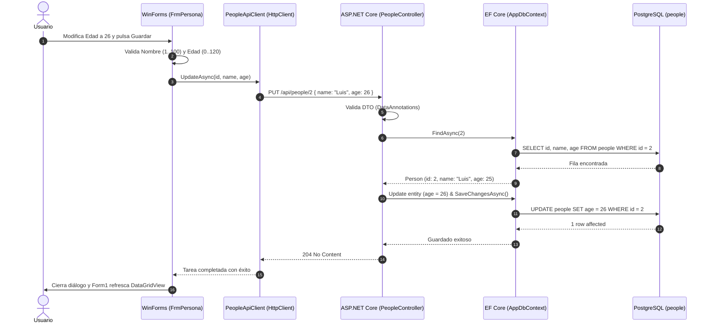

# REPORTE_POR_CAPAS.md - Reporte Técnico de Migración

## 1. Resumen Ejecutivo
Transformación de la aplicación cliente-servidor de dos capas con acoplamiento directo a base de datos (`CrudWindowsFormsLinq`) a una arquitectura moderna desacoplada en cuatro capas:
1. **Cliente**: Windows Forms (.NET Framework 4.8) consumiendo API REST vía HTTP asíncrono con `HttpClient`.
2. **API REST**: ASP.NET Core (.NET 8 Web API) con endpoints normalizados, DTOs y validaciones ProblemDetails.
3. **Acceso a Datos**: Entity Framework Core 8 con proveedor `Npgsql`, consultas LINQ traducidas a SQL y `ILike`.
4. **Base de Datos**: PostgreSQL 16 sobre Ubuntu 24.04 LTS con usuario restringido `crud_app`.
5. **Infraestructura**: Aprovisionamiento automatizado en Ubuntu 24.04, servicio systemd `crudapi` y reglas de firewall UFW.

---

## 2. Reporte Detallado por Capas

### Capa 1: Base de Datos (PostgreSQL 16)
- **Objetivo y responsabilidad**: Almacenamiento persistente, integridad relacional mediante constraints (`CHECK (age BETWEEN 0 AND 120)`), secuencia auto-incremental (`IDENTITY`) y control de acceso mínimo.
- **Estado inicial**: Base de datos SQL Server (`dbo.People`, script `CrudWindowsForms.sql`). Acceso con credenciales integradas o SA.
- **Estado final**: PostgreSQL 16 con base `crud_windows_forms`, esquema `public.people`, usuario sin privilegios `crud_app`. Escucha exclusivamente en `localhost` (127.0.0.1).
- **Archivos creados/modificados**:
  - `database/postgres/01_schema.sql`
- **Decisiones técnicas**: Tablas y columnas en minúsculas snake_case para compatibilidad PostgreSQL; restricción estricta de edad a nivel esquema.
- **Comandos ejecutados**: (Se irán registrando en T-03 y T-10)
- **Pruebas y evidencias**: (En desarrollo)

---

### Capa 2: Acceso a Datos (EF Core + Npgsql)
- **Objetivo y responsabilidad**: Mapeo objeto-relacional entre la entidad C# `Person` y la tabla `people`, generación y aplicación de migraciones code-first y ejecución eficiente de consultas con LINQ.
- **Estado inicial**: LINQ to SQL (.dbml generado para SQL Server), acoplamiento directo a `System.Data.Linq`.
- **Estado final**: EF Core 8.x con Npgsql. Contexto `AppDbContext`, mapeo explícito en `OnModelCreating`, consultas `AsNoTracking()` para lecturas, y función `EF.Functions.ILike` para búsquedas case-insensitive.
- **Archivos creados/modificados**:
  - `src/Api/Data/AppDbContext.cs`
  - `src/Api/Models/Person.cs`
  - `src/Api/Migrations/*`
- **Decisiones técnicas**: Code-first con migraciones para versionado del esquema; script SQL de referencia para auditoría DBA.

---

### Capa 3: API REST (ASP.NET Core Web API .NET 8)
- **Objetivo y responsabilidad**: Exposición de servicios RESTful, validación de datos de entrada (Server-Side Validation), transformación de DTOs, manejo centralizado de excepciones y documentación OpenAPI/Swagger en desarrollo.
- **Estado inicial**: Inexistente (el cliente se conectaba directo a SQL Server).
- **Estado final**: Web API ASP.NET Core (.NET 8) con endpoints en `/api/people`:
  - `GET /api/people`
  - `GET /api/people?search={text}`
  - `GET /api/people/{id}`
  - `POST /api/people`
  - `PUT /api/people/{id}`
  - `DELETE /api/people/{id}`
- **Archivos creados/modificados**:
  - `src/Api/Controllers/PeopleController.cs` (o Minimal API)
  - `src/Api/DTOs/PersonCreateDto.cs`, `PersonUpdateDto.cs`, `PersonResponseDto.cs`
  - `src/Api/Program.cs`
  - `src/Api/appsettings.Example.json`
- **Decisiones técnicas**: Uso de ProblemDetails estándar RFC 7807 para errores 400/404; logging sin divulgar stacktraces en producción.

---

### Capa 4: Cliente Windows Forms
- **Objetivo y responsabilidad**: Presentación visual, captura de eventos de usuario, validación inmediata del formulario y comunicación HTTP asíncrona hacia la API.
- **Estado inicial**: Formularios acoplados a `PeopleLinqDB` y a las clases generadas por LINQ to SQL. Bloqueo de UI por llamadas síncronas.
- **Estado final**: Formularios desacoplados usando `PeopleApiClient`, llamadas `async/await`, POCO `Person` sin referencias a `System.Data.Linq`.
- **Archivos creados/modificados/eliminados**:
  - Creados: `src/Client.WinForms/PeopleApiClient.cs`, `src/Client.WinForms/Person.cs`
  - Modificados: `src/Client.WinForms/Form1.cs`, `src/Client.WinForms/FrmPersona.cs`, `src/Client.WinForms/App.config`
  - Eliminados: `Personas.dbml`, `Personas.designer.cs`, `Personas.dbml.layout`, `PeopleLinqDB.cs`
- **Decisiones técnicas**: Conservar firmas de métodos para minimizar cambios en formularios; timeout de 10s y mensajes en español acordes al comportamiento previo.

---

### Capa 5: Infraestructura y Despliegue (Ubuntu 24.04 LTS)
- **Objetivo y responsabilidad**: Alojamiento seguro y confiable de la base de datos y la API.
- **Estado inicial**: Entorno monomáquina Windows con SQL Server Express.
- **Estado final**: Máquina Ubuntu 24.04 con PostgreSQL 16 local, API ejecutada como daemon systemd `crudapi.service` en puerto 5000, UFW bloqueando accesos externos a PostgreSQL.
- **Archivos creados**:
  - `deploy/provision-ubuntu.sh`
  - `deploy/crudapi.service`
  - `deploy/ufw-y-red.md`

---

## 3. Diagrama de Flujo de Petición ("Editar Persona")

---

## 4. Matriz de Riesgos y Recomendaciones Futuras

| Aspecto | Riesgo Identificado | Mitigación Implementada | Recomendación Futura |
|---|---|---|---|
| **Seguridad de Red** | Exposición de PostgreSQL a la red externa | PostgreSQL configurado en `127.0.0.1`, UFW bloquea puerto 5432 | Túnel SSH exclusivo para administración DBA (DBeaver/pgAdmin) |
| **Transporte** | Tráfico HTTP en texto plano | Aislamiento en red local / VM | Implementar terminación TLS/HTTPS con Let's Encrypt o Nginx Reverse Proxy |
| **Autenticación** | Endpoints de la API abiertos sin credenciales | Validación de orígenes y uso de red privada | Incorporar autenticación JWT o API Key para clientes autorizados |
| **Escalabilidad / Datos** | `GET /api/people` sin paginación devuelve toda la tabla | Adecuado para volumen actual de prueba | Agregar paginación (`pageNumber`, `pageSize`) si la tabla supera 1000 filas |
| **Persistencia / Respaldo**| Pérdida de datos por fallo en disco de VM | Script de creación y datos de prueba versionados | Configurar cron de `pg_dump` diario con retención de copias |
